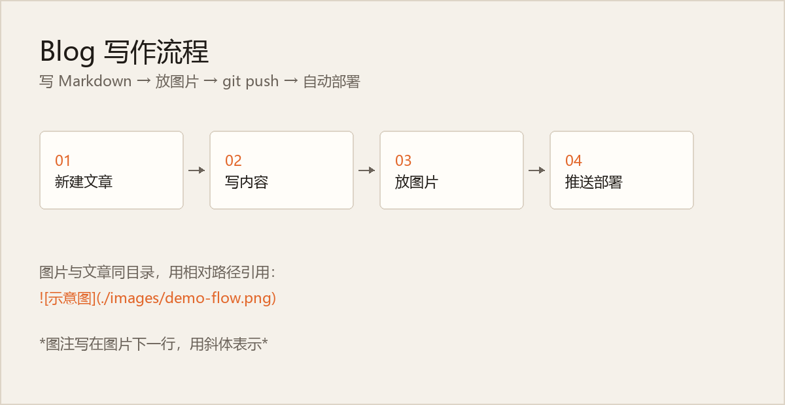

This article is both an example and an instruction manual. I’ll forget how to put pictures in the future, so I’ll come back and look here.



*The legend is written on the next line of the picture, wrapped in a pair of asterisks, and will automatically become a legend when built*

## Create a new article

Execute in the project directory:

```bash
npm run new "文章标题"
```

It will generate a Markdown file with frontmatter under `src/content/blog/`.

You can also create a new one manually. The file name is the path in the URL:

```
src/content/blog/my-post.md  →  /blog/my-post/
```

## How to put pictures

**The pictures are uniformly placed in the `src/content/blog/images/` directory**, and then referenced using relative paths in the article:

```markdown

```

Pay attention to three points:

1. The path starts with `./images/`, **Do not write `/images/`** - this site is deployed under a sub-path, the absolute path will be 404
2. Write the picture description in square brackets. This is also an alternative text for barrier-free screen reading.
3. Write `*图注*` on the next line of the picture, and it will be rendered into a small description in the center.

## formula

Use a single dollar sign for inline formulas: $E = mc^2$.

Block-level formulas are placed on their own line with two dollar signs:

$$
\hat{\beta} = (X^{\top}X)^{-1}X^{\top}y
$$

## code

There is a "Copy" button in the upper right corner of the code block, which only appears when the mouse is moved up.

```python
def hello(name: str) -> str:
    return f"你好，{name}"
```

## Draft and publish

If you write `draft: true` in frontmatter, the article will not appear in any lists or RSS.

After changing the content:

```bash
git add .
git commit -m "post: 新文章"
git push
```

GitHub Actions will automatically build and publish after the push, which takes about a minute.