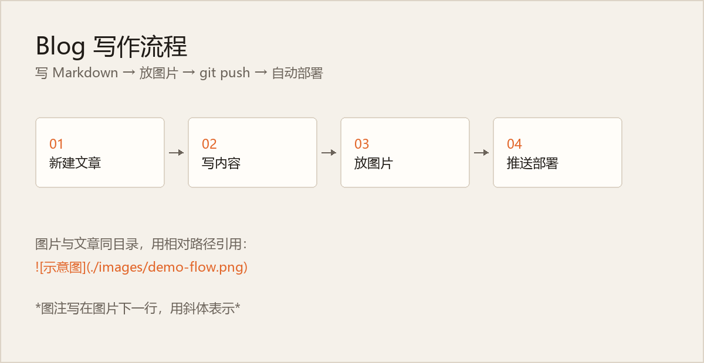

这篇既是示例，也是说明书。以后忘了怎么放图片，回来看这里。



*图注写在图片的下一行，用一对星号包起来，构建时会自动变成图注*

## 新建一篇文章

在项目目录下执行：

```bash
npm run new "文章标题"
```

它会在 `src/content/blog/` 下生成一个带好 frontmatter 的 Markdown 文件。

也可以手动新建，文件名就是网址里的路径：

```
src/content/blog/my-post.md  →  /blog/my-post/
```

## 怎么放图片

**图片统一放在 `src/content/blog/images/` 目录**，然后在文章里用相对路径引用：

```markdown

```

注意三点：

1. 路径以 `./images/` 开头，**不要写 `/images/`**——本站部署在子路径下，绝对路径会 404
2. 方括号里写图片说明，这同时是无障碍读屏用的替代文字
3. 图片下一行写 `*图注*`，就会渲染成居中的小字说明

## 公式

行内公式用单个美元符号：$E = mc^2$。

块级公式用两个美元符号单独成行：

$$
\hat{\beta} = (X^{\top}X)^{-1}X^{\top}y
$$

## 代码

代码块右上角有「复制」按钮，鼠标移上去才出现。

```python
def hello(name: str) -> str:
    return f"你好，{name}"
```

## 草稿与发布

frontmatter 里写 `draft: true`，文章就不会出现在任何列表和 RSS 里。

改完内容后：

```bash
git add .
git commit -m "post: 新文章"
git push
```

推送后 GitHub Actions 会自动构建并发布，大约一分钟。
